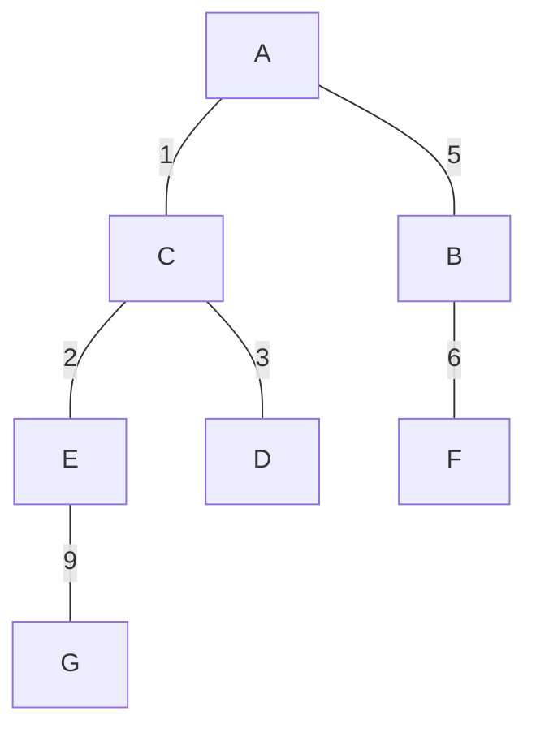

# 最短路径（Dijkstra）与最小生成树（Kruskal）/ Shortest Paths (Dijkstra) and Minimum Spanning Trees (Kruskal)

> 材料时间 / Material dates：2026-10-29 至 2026-11-02 的学习对话整理，不是课堂原始记录。入口见 [[Courses/2026_fall/recent_learning_review]]。  
> Organized from study conversations dated 2026-10-29 to 2026-11-02; this is not an original class transcript.

## 问题与直觉 / Problem and Intuition

带权图上有两类常被混淆的问题：

Two weighted-graph problems are often confused:

- **最短路径**：从指定起点到每个节点，花费最少是多少、怎么走？用 Dijkstra。  
  **Shortest paths:** from a given start, what is the cheapest cost and route to each node? Use Dijkstra.
- **最小生成树（MST）**：用总权重最小的一组边把所有节点连起来，且不形成环。用 Kruskal，不需要起点。  
  **Minimum spanning tree:** connect all nodes with the cheapest set of edges and no cycle. Use Kruskal; no start node is needed.

最短路径树和最小生成树一般不是同一棵树：前者对“某个起点”最优，后者对“总成本”最优。

A shortest-path tree and an MST are generally different: one is optimal for a chosen start, the other for total cost.

## Dijkstra：距离与前驱 / Dijkstra: Distances and Predecessors

**条件**：边权非负。负权边会让“已确定的最短距离”失效。

**Condition:** edge weights must be nonnegative; negative edges invalidate finalized distances.

1. 起点距离为 $0$，其余为 $\infty$。  
   Set the start distance to $0$ and all others to $\infty$.
2. 每次取出未确定节点中距离最小的 $u$，将其确定。  
   Repeatedly finalize the unfinalized node $u$ with the smallest distance.
3. 对 $u$ 的每个邻居 $v$：若 $d(u)+w(u,v)<d(v)$，更新 $d(v)$，并把 $v$ 的前驱设为 $u$。  
   For each neighbor $v$, if $d(u)+w(u,v)<d(v)$, update $d(v)$ and set $v$'s predecessor to $u$.

**前驱（Previous Node）只填一个节点**：到达该节点前的最后一站，不是完整路径。完整路径通过前驱倒推得到。

**The predecessor is a single node,** the last stop before reaching it, not the full path. The full path is recovered by following predecessors backward.

**测验结果（对话中的答案表）**：

**Quiz result from the conversation:**

| 节点 / Node | 距离 / Distance from A | 前驱 / Previous |
| --- | ---: | --- |
| A | 0 | — |
| B | 24 | A |
| C | 5 | A |
| D | 6 | C |
| E | 34 | F |
| F | 14 | D |

倒推到 E：$E\leftarrow F\leftarrow D\leftarrow C\leftarrow A$，路径 `A, C, D, F, E`。到 F 的成本 $5+1+8=14$ 与表一致。原图在截图中，未包含在材料里，所以本页无法独立验证每个距离是否最优，只验证了表内数值彼此一致。

Backtracking to E gives the path `A, C, D, F, E`, and the cost to F, $5+1+8=14$, matches the table. The graph was in a screenshot that was not included, so only the internal consistency of the table is checked here.

## Kruskal：从最便宜的边开始 / Kruskal: Start from the Cheapest Edge

1. 把所有边按权重从小到大排序。  
   Sort all edges by weight.
2. 依次考虑每条边：两端尚未连通 → 加入；已经连通 → 跳过（加入会成环）。  
   For each edge, add it if its endpoints are not yet connected; otherwise skip it because it would form a cycle.
3. $n$ 个节点选到 $n-1$ 条边时停止。  
   Stop after selecting $n-1$ edges for $n$ nodes.

判断“是否已连通”：看加入前两端之间是否已有一条由已选边组成的路。程序中常用并查集（union–find）做这一步。

To test connectivity, ask whether the chosen edges already form a path between the endpoints; programs typically use union–find.

## 完整例题：7 个节点的 Kruskal / Worked Example: Kruskal on 7 Nodes

对话中列出的边（权重）：A-C 1，C-E 2，C-D 3，A-D 4，A-B 5，B-F 6，E-F 7，D-F 8，E-G 9。

Edges listed in the conversation, with weights, are given above.

| 边 / Edge | 权重 / Weight | 操作 / Action | 原因 / Reason |
| --- | ---: | --- | --- |
| A-C | 1 | 加入 / add | 连接 A、C / joins A and C |
| C-E | 2 | 加入 / add | 接入 E / brings in E |
| C-D | 3 | 加入 / add | 接入 D / brings in D |
| A-D | 4 | 跳过 / skip | 已有 A-C-D，会成环 / A-C-D already connects them |
| A-B | 5 | 加入 / add | 接入 B / brings in B |
| B-F | 6 | 加入 / add | 接入 F / brings in F |
| E-F | 7 | 跳过 / skip | E-C-A-B-F 已连通 / already connected |
| D-F | 8 | 跳过 / skip | 已连通 / already connected |
| E-G | 9 | 加入 / add | 接入 G，共 6 条边，结束 / brings in G; 6 edges, done |

最小生成树：A-C、C-E、C-D、A-B、B-F、E-G，总权重 $1+2+3+5+6+9=26$。用并查集程序按上表的边重算，得到相同的 6 条边和总权重。

The MST has total weight $26$. A union–find program run on these edges reproduces the same six edges and total.

## 易错点 / Common Mistakes

- 前驱一栏写完整路径：只写最后一站。  
  Writing the whole path in the predecessor column; write only the last stop.
- Kruskal 只按权重排序、不检查环：A-D（4）比 A-B（5）便宜，但会成环，必须跳过。  
  Sorting by weight without checking cycles: A-D is cheaper than A-B but forms a cycle.
- 用 Kruskal 回答“从 A 到 E 最短多少”：MST 中的路径不一定是最短路径。  
  Using an MST path as a shortest path; they need not coincide.

## 关联笔记 / Related Notes

- [[CMPSC/6.Hash_Tables_and_Graphs/README]] — 本章学习顺序 / Study order for this chapter
- [[CMPSC/6.Hash_Tables_and_Graphs/bfs_traversal]] — 无权图的逐层遍历 / Level-by-level traversal of unweighted graphs

## 来源 / Sources

- ChatGPT 对话 / ChatGPT conversation：[Quiz Page Viewing](https://chatgpt.com/c/6ae810e7-7154-832e-b44a-fd953704cfe3) — Dijkstra 距离表与前驱、Kruskal 选边顺序与生成树 / The Dijkstra table with predecessors and the Kruskal edge order and tree.

[//begin]: # "Autogenerated link references for markdown compatibility"
[//end]: # "Autogenerated link references"
