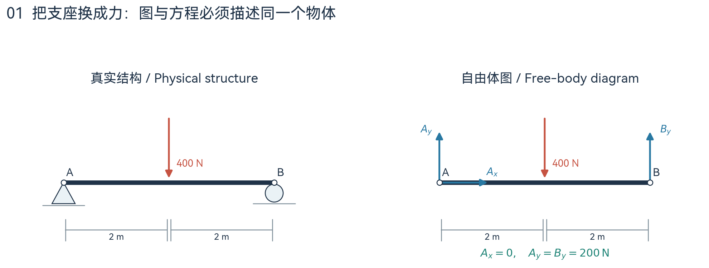
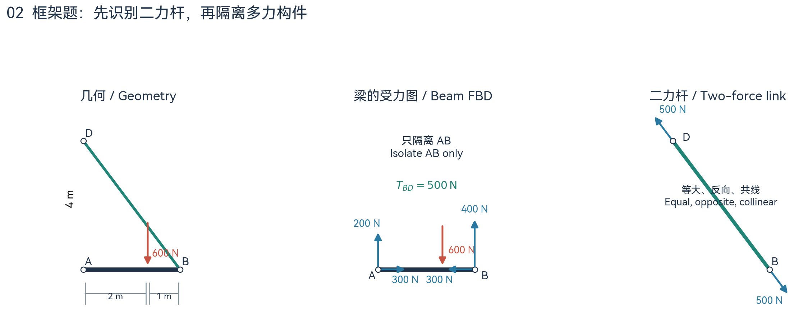
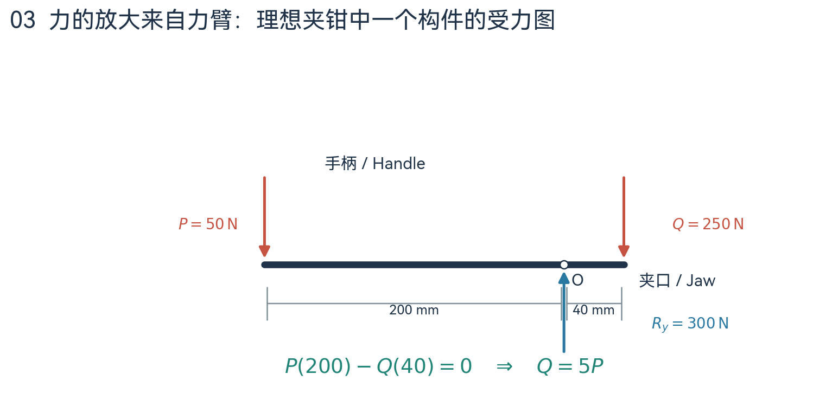
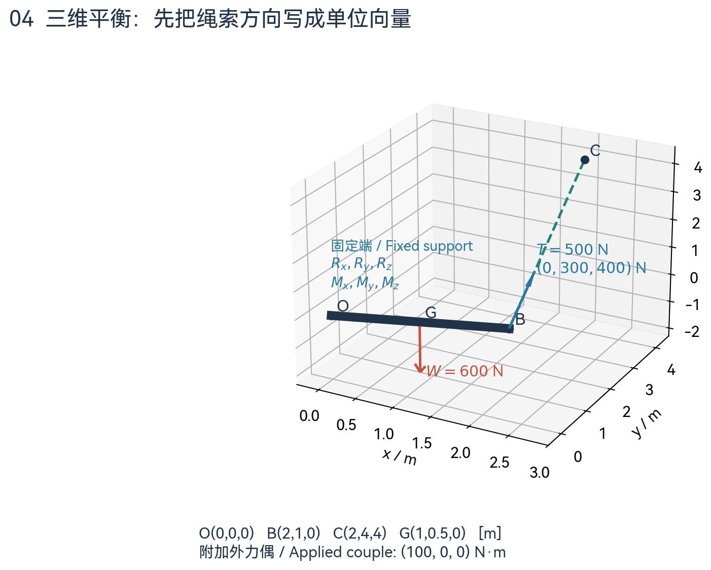
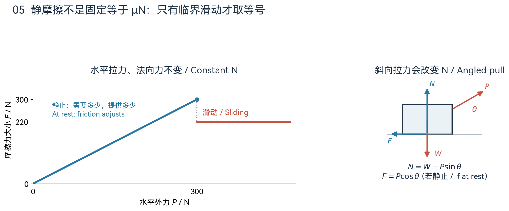
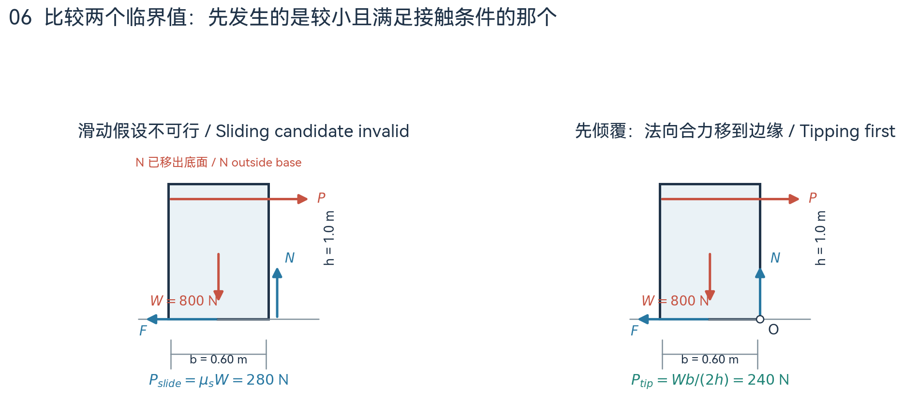
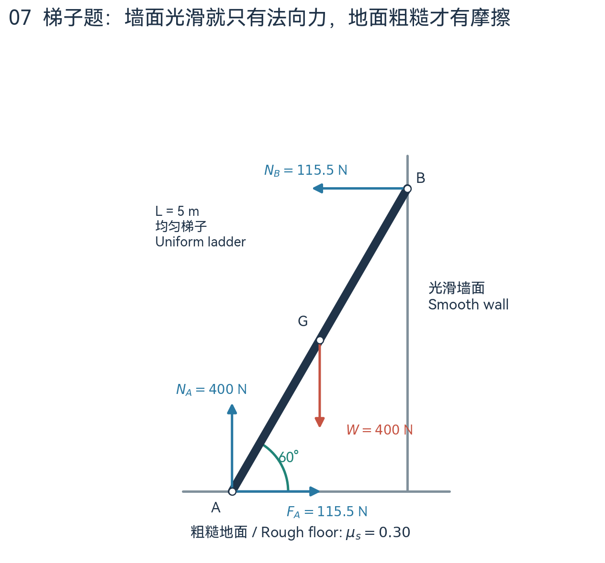
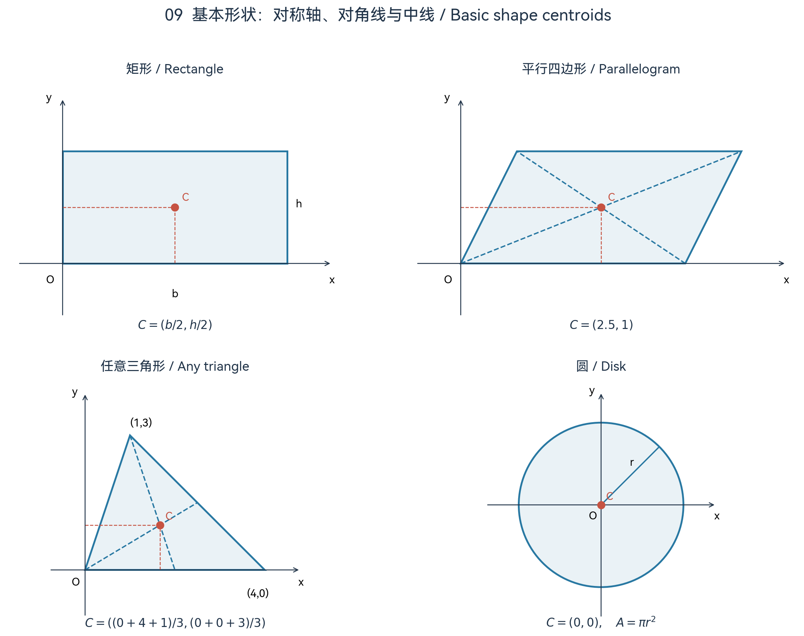
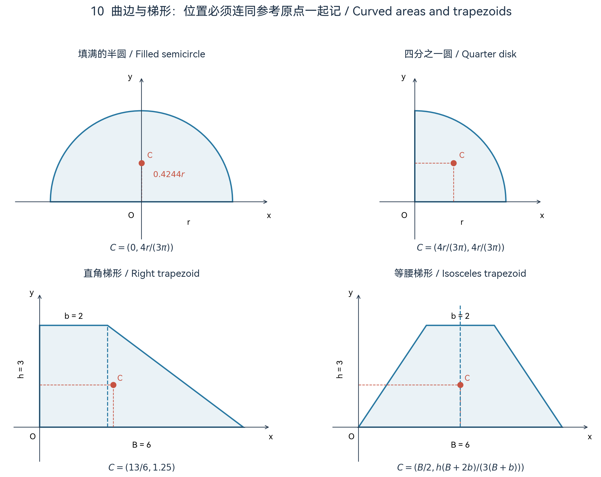
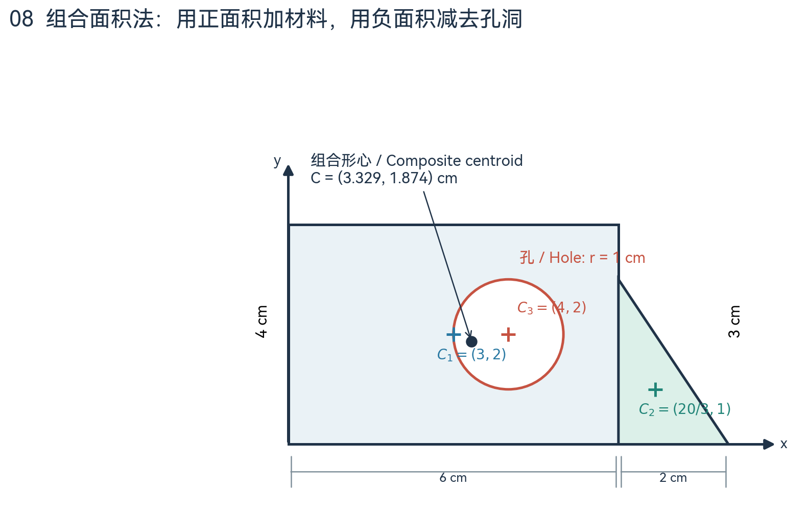

# Exam 2 图解复习笔记 / Illustrated Review

把每道题变成一个清楚的物体、一张可信的受力图和几条有物理意义的方程。本文依据 Hibbeler《Statics and Mechanics of Materials》第 6 版整理，面向 EMCH 210 Exam 2；例题和插图均为原创教学材料，数值不是考试原题。  
Turn each problem into a clearly isolated body, a consistent free-body diagram, and equations with physical meaning. This review follows Hibbeler, *Statics and Mechanics of Materials*, 6th edition, for EMCH 210 Exam 2. All worked examples and illustrations here are original teaching materials, not actual exam questions.

飞书版本 / Feishu copy：[EMCH 210 · Exam 2 图解复习](https://mcnih7qzaec2.feishu.cn/docx/IRt3dJ5LXoCJtexyrXicpOujnFf)。

## 1. 这次该复习什么 / What to Study

老师 2026 年 10 月 6 日的通知明确：考试共 4 道题，主要围绕 Homework 4；以前作业的相关概念也可能用到。四个主题如下，但通知没有承诺每个主题恰好对应一道题。  
The instructor's October 6 announcement specifies four problems, primarily based on Homework 4, with relevant earlier concepts also applicable. The four topics below are listed, but a one-to-one topic-to-problem mapping is not promised.

| 考试主题 / Exam topic | 教材位置 / Textbook location | 需要做到 / Target skill |
| --- | --- | --- |
| 框架与机械 / Frames and machines | §5.5，印刷页 233–240 | 拆构件、辨二力杆、求连接力 / Isolate members, identify two-force links, solve joint forces |
| 单个刚体三维平衡 / One rigid body in 3-D | §4.5–4.6，印刷页 173–181 | 识别支座、写力向量、算叉积 / Model supports, express force vectors, calculate cross products |
| 含摩擦的二维平衡 / 2-D equilibrium with friction | §4.7–4.8，印刷页 186–199 | 判方向、查临界、比较滑动与倾覆 / Determine directions, check limits, compare sliding and tipping |
| 组合面积形心 / Composite-area centroids | §6.1–6.2，重点印刷页 270–274 | 拆面积、负孔洞、统一坐标 / Decompose areas, subtract holes, use one coordinate system |

**考试闭卷、闭笔记，没有公式表。** 可使用科学或图形计算器，不能用手机当计算器。平衡题必须附与方程一致的自由体图。形心题明确使用组合面积法，不要求积分。  
**The exam is closed book and closed notes, with no equation sheet.** A scientific or graphing calculator is permitted; a phone cannot be used as a calculator. Equilibrium solutions must include supporting free-body diagrams. Centroids are computed by composite areas, without integration.

阅读顺序建议：先用第 2 节复习受力图，再完成第 3–6 节的例题；最后合上笔记，用第 8 节自测。本文中的力均使用 N，除非特别注明；力矩使用 N·m，形心例题使用 cm。  
Suggested route: review free-body diagrams in Section 2, work through Sections 3–6, then close the notes and attempt Section 8. Forces are in N unless stated otherwise; moments use N·m and the centroid example uses cm.

## 2. 所有平衡题的共同语言 / The Language of Equilibrium

### 2.1 平衡意味着什么 / What Equilibrium Means

物体既不能有平移加速度，也不能有转动加速度。因此，“向上和向下的力一样大”还不够：两股反向力若不共线，仍会使物体转动。二维刚体通常有三条独立平衡方程，三维刚体最多有六条。  
A body must have neither translational nor angular acceleration. Equal upward and downward forces are insufficient if their lines of action create a turning effect. A planar rigid body usually supplies three independent equilibrium equations; a spatial rigid body supplies at most six.

$$\sum F_x=0,\qquad\sum F_y=0,\qquad\sum M_O=0$$

$$\sum F_x=\sum F_y=\sum F_z=0,\qquad\sum M_x=\sum M_y=\sum M_z=0$$

式中的 $O$ 可以选在物体上，也可以选在物体外。选点不是为了改变物理结果，而是为了让尽可能多的未知力矩变成零。不同取矩点列出的方程不一定独立，不能靠多换几个点就获得无限多条新方程。  
The moment center $O$ may lie on or off the body. Choose it to eliminate moments of unknown forces, not to change the physics. Equations about different centers are not necessarily independent; changing centers does not create unlimited new information.

### 2.2 自由体图：先划定边界 / First Choose a Boundary

自由体图的关键是确定“我正在分析谁”。把选中的物体从环境中拿出来，把被移走的支座、绳索、邻接构件对它的作用换成力或力偶；画出重量、外载荷、坐标和必要尺寸。只画边界外的作用，不把整个系统内部互相抵消的力重复画进来。  
A free-body diagram begins by deciding which body is being analyzed. Isolate it and replace removed supports, cables, and neighboring members with their forces or couples. Include weight, applied loads, coordinates, and required dimensions. Interactions wholly inside the chosen system are internal and should not be counted again.

图 01｜左边是梁及支座，右边才是列方程的对象。取 $A$ 点矩：$4B_y-400(2)=0$，所以 $B_y=200\,\mathrm{N}$；再由竖直平衡求得 $A_y=200\,\mathrm{N}$，由水平平衡求得 $A_x=0$。图示是无自重梁。  
Figure 01 | The physical supports are replaced by reactions on the isolated beam. Moments about $A$ give $4B_y-400(2)=0$, hence $B_y=200\,\mathrm{N}$. Vertical and horizontal equilibrium then give $A_y=200\,\mathrm{N}$ and $A_x=0$. Beam weight is neglected.

| 支座或连接 / Support or connection | 常见模型 / Common reaction model | 判断依据 / Reason |
| --- | --- | --- |
| 绳索 / Cable | 一个沿绳的拉力 $T$ / One tension along the cable | 能拉不能推 / Pulls, cannot push |
| 光滑接触或滚轮 / Smooth contact or roller | 一个垂直接触面的 $N$ / One normal force | 无切向摩擦 / No tangential friction |
| 二维销钉 / Planar pin | $A_x,A_y$，无反力偶 / Two force components, no reaction couple | 阻止平移，允许转动 / Prevents translation, permits rotation |
| 二维固定端 / Planar fixed support | $A_x,A_y,M_A$ / Two forces and one couple | 同时阻止平移和转动 / Prevents translation and rotation |
| 三维球铰 / Ball-and-socket joint | $A_x,A_y,A_z$，无反力偶 / Three forces, no reaction couples | 允许绕各轴转动 / Permits rotation about every axis |
| 三维固定端 / Spatial fixed support | 三个力、三个力偶 / Three forces and three couples | 六个刚体运动方向均受限制 / Restrains all six rigid-body motions |

**支座的名称不是全部。** 三维轴承或铰链的反力矩取决于它是单独工作，还是与其他正确对齐的支座共同约束物体。教材 Table 4–2（印刷页 174–175）和 Example 4.9 特别说明了这一点；做题时以题图、轴向和题目假设为准。  
**A support's name is not the whole model.** Reaction couples at spatial bearings or hinges depend on whether they act alone or with other properly aligned supports. Table 4–2, printed pages 174–175, and Example 4.9 explicitly discuss this. Follow the diagram, shaft orientation, and stated assumptions.

### 2.3 力矩：看垂直距离 / Moments Use Perpendicular Distance

二维中可以统一规定逆时针为正。力矩大小是 $Fd_\perp$，其中 $d_\perp$ 是取矩点到力的作用线的垂直距离，不能随意拿杆长代替。若力已拆成分量，则作用点相对 $O$ 的坐标为 $(x,y)$ 时：  
In 2-D, choose counterclockwise moments as positive. The magnitude is $Fd_\perp$, where $d_\perp$ is the perpendicular distance to the force's line of action, not automatically the member length. With force components applied at $(x,y)$ relative to $O$:

$$M_O=xF_y-yF_x$$

力偶矩表示纯转动效应，其合力为零。它直接进入取矩方程，不再乘一个“到取矩点的距离”；移动取矩点不会改变该力偶矩。力的单位是 N，力矩的单位是 N·m，二者不能在同一条力平衡式中相加。  
A couple produces a pure turning effect with zero resultant force. Add it directly to the moment equation; do not multiply it by another distance. Its moment is independent of the chosen center. Forces in N and moments in N·m cannot be added in a force equation.

## 3. 框架与机械 / Frames and Machines

### 3.1 为什么必须拆开 / Why Members Must Be Isolated

桁架的理想杆件通常是二力杆，节点法主要处理沿杆轴的拉压；框架和机械则常含多力构件，它们会在不同位置承受载荷或力偶。因此框架题通常要隔离整根构件，再用刚体平衡，而不是把每根构件都当成只受轴力的桁架杆。框架用于承载，机械用于传递和改变力的效果。  
Ideal truss members are typically two-force members, analyzed through axial tension or compression. Frames and machines often contain multiforce members with loads or couples applied at different locations. Analyze their complete members as rigid bodies rather than treating every member as an axial truss bar. Frames support loads; machines transmit and modify forces.

**二力杆的判断条件：** 只受两处外力作用，没有其他外载荷或力偶；若忽略自重，两端为销连接且中间无载荷的杆是常见例子。平衡要求两端力等大、反向、共线，其方向沿两个受力点的连线。杆即使弯曲，也不能仅凭外形认定不是二力杆。  
**A two-force member** has forces applied at only two locations, with no additional external loads or couples. A weightless, unloaded pin-connected link is a common example. Equilibrium requires equal, opposite, collinear end forces, directed along the line connecting the application points. A bent shape does not automatically disqualify a member.

分析顺序可以很灵活：整体图适合求外部支座反力，局部图适合求内部连接力。优先选择未知量最少的对象，尤其是二力杆所连接的构件；再选择能消去最多未知量的取矩点。图与方程中的力名和箭头必须始终对应。  
Use the whole assembly to find external reactions and isolated members to find internal joint forces. Begin with a body having few unknowns, particularly one connected to a two-force link, and choose a moment center that eliminates several unknowns. Keep force names and directions consistent between diagrams and equations.

### 3.2 完整例题：梁与斜拉杆 / Worked Example: Beam and Link

设无自重刚性梁 $AB$ 长 $3\,\mathrm{m}$，在 $A$ 用销支承；$B$ 通过无自重二力杆连接到 $D$。以 $A=(0,0)$ 为原点，$B=(3,0)$，$D=(0,4)$，坐标单位为 m。在距 $A$ 点 $2\,\mathrm{m}$ 处作用竖直向下的 $600\,\mathrm{N}$ 力，求拉杆力和 $A$ 点反力。  
A weightless rigid beam $AB$, $3\,\mathrm{m}$ long, is pinned at $A$ and connected at $B$ to a weightless two-force link ending at $D$. Coordinates in m are $A=(0,0)$, $B=(3,0)$, $D=(0,4)$. A downward $600\,\mathrm{N}$ force acts $2\,\mathrm{m}$ from $A$. Find the link force and pin reactions.

图 02｜先假设杆 $BD$ 受拉。它对梁在 $B$ 的作用沿 $B\to D$，所以水平分量向左、竖直分量向上；杆长是 $5\,\mathrm{m}$，方向比例为 $-3/5$ 和 $4/5$。  
Figure 02 | Assume link $BD$ is in tension. Its force on the beam points from $B$ toward $D$, with a leftward horizontal component and an upward vertical component. The link length is $5\,\mathrm{m}$, so its direction components are $-3/5$ and $4/5$.

$$B_x=-\frac35T,\qquad B_y=\frac45T$$

**先取 $A$ 点矩。** $A_x$ 和 $A_y$ 通过取矩点，$B_x$ 的作用线也通过 $A$，因此都不产生矩，只剩一个未知量：  
**Take moments about $A$ first.** Both pin reactions pass through $A$, and the horizontal component at $B$ also has zero moment about $A$. Only one unknown remains:

$$\sum M_A=0:\qquad3\left(\frac45T\right)-600(2)=0\quad\Rightarrow\quad T=500\,\mathrm{N}$$

**再用力平衡。** 已知 $B_x=-300\,\mathrm{N}$、$B_y=400\,\mathrm{N}$，代入得到：  
**Then use force equilibrium.** With $B_x=-300\,\mathrm{N}$ and $B_y=400\,\mathrm{N}$:

$$\sum F_x=0:\quad A_x-300=0\quad\Rightarrow\quad A_x=300\,\mathrm{N}$$

$$\sum F_y=0:\quad A_y+400-600=0\quad\Rightarrow\quad A_y=200\,\mathrm{N}$$

**检查另一张图。** 梁对杆在 $B$ 的作用是 $(+300,-400)\,\mathrm{N}$，恰好与杆对梁的作用相反；杆在 $D$ 的支座作用为 $(-300,+400)\,\mathrm{N}$。把梁和杆作为整体时，$B$ 处的两股力成为内力而消失。若把它们仍画成整体外力，就会重复计数。  
**Check the other body.** The beam exerts $(+300,-400)\,\mathrm{N}$ on the link at $B$, opposite to the link's force on the beam. The support force on the link at $D$ is $(-300,+400)\,\mathrm{N}$. When beam and link are isolated together, the forces at $B$ become internal and cancel. Including them as external forces would double-count the interaction.

算出的 $T$ 为正，说明最初“受拉”的假设正确。如果对象是可受压的刚性杆，负值代表受压；如果对象是只能受拉的绳索，负张力就意味着该绳索的绷紧模型不成立。  
Positive $T$ confirms the assumed tension. A negative axial force can indicate compression in a rigid link. A cable, however, cannot sustain negative tension; such a result invalidates the assumed taut-cable model.

### 3.3 机械：长力臂换取大夹持力 / Mechanical Advantage

夹钳不是凭空产生力：手柄的力臂长，夹口的力臂短，绕销钉的力矩需要互相平衡。下面只隔离夹钳中的一个理想构件，假设重量忽略，输入力和夹口接触力均竖直，其垂直力臂分别为 $200\,\mathrm{mm}$ 和 $40\,\mathrm{mm}$。  
A clamp amplifies force through leverage: the long handle arm and short jaw arm must balance their moments about the pin. Isolate one idealized weightless member, with vertical input and jaw-contact forces having perpendicular arms of $200\,\mathrm{mm}$ and $40\,\mathrm{mm}$.

图 03｜若手柄输入力 $P=50\,\mathrm{N}$，对销钉 $O$ 取矩后，$50(200)-Q(40)=0$，所以 $Q=250\,\mathrm{N}$。竖直力平衡给出该构件的销钉反力 $R_y=50+250=300\,\mathrm{N}$。这里用 mm 计算力矩，所有力臂必须统一为 mm。  
Figure 03 | For handle input $P=50\,\mathrm{N}$, moments about $O$ give $50(200)-Q(40)=0$, so $Q=250\,\mathrm{N}$. Vertical equilibrium gives the pin reaction on this member, $R_y=300\,\mathrm{N}$. All moment arms here use mm consistently.

$$\frac QP=\frac{d_P}{d_Q}=5$$

注意 $Q$ 在图中是工件对夹口的作用，夹口对工件的作用方向相反。对称夹钳中两侧各有 $250\,\mathrm{N}$ 的接触力，不应不看问题所求就把“单侧接触力”写成 $500\,\mathrm{N}$；尤其是两股反向力的向量合力并不是二者大小之和。  
Here $Q$ is the workpiece's force on the jaw; the jaw's force on the workpiece is opposite. In a symmetric clamp each side may exert $250\,\mathrm{N}$, but that does not make a single-side contact force $500\,\mathrm{N}$. The vector resultant of two opposite forces is not the sum of their magnitudes.

遇到滑轮时也先划定边界：理想无摩擦滑轮上的同一根连续绳张力相同，滑轮受两段绳索拉力时，应按两段绳的方向向量相加。只有两段力平行同向时，合力大小才直接等于 $2T$。  
For pulleys, define the isolated system first. Tension is constant along one continuous ideal cable passing over a frictionless pulley. Add the two cable forces as vectors; their resultant has magnitude $2T$ only when the segments pull in parallel and in the same direction.

## 4. 单个刚体的三维平衡 / A Single Rigid Body in 3-D

### 4.1 三个力、三个矩 / Three Forces and Three Moments

三维题难在空间方向，而不是多了一套平衡原理。最稳的做法是：建坐标，写出支座允许的未知量，把每股力变成 $(F_x,F_y,F_z)$，然后计算它相对同一取矩点的矩。先查题目是否给了重量；若给的是质量，则用 $W=mg$，不要把 kg 直接当作 N。  
Spatial problems are difficult because of directions, not because equilibrium changes. Establish axes, model the allowed support reactions, express each force as $(F_x,F_y,F_z)$, and compute moments about one common center. If mass rather than weight is given, use $W=mg$; kg is not a force unit.

若绳索从物体上的 $B$ 拉向锚点 $C$，先用“终点减起点”得到方向向量，再除以长度得到单位向量。单位向量没有长度单位，其长度应为 1。  
For a cable pulling from body point $B$ toward anchor $C$, subtract starting coordinates from ending coordinates, then divide by the length. The resulting unit vector is dimensionless and should have magnitude 1.

$$\mathbf r_{BC}=(x_C-x_B,\ y_C-y_B,\ z_C-z_B),\qquad\mathbf F_{BC}=T\frac{\mathbf r_{BC}}{|\mathbf r_{BC}|}$$

力矩中的位置向量则从取矩点 $O$ 指向力的作用点。它与上面的绳索方向向量有不同作用：一个告诉你“力在哪里”，一个告诉你“力朝哪里”。  
The position vector in the moment calculation points from the moment center $O$ to the force's application point. It answers where the force acts, while the cable vector answers which direction it acts.

$$\mathbf M_O=\mathbf r\times\mathbf F=(r_yF_z-r_zF_y,\ r_zF_x-r_xF_z,\ r_xF_y-r_yF_x)$$

这个展开式已经包含叉积中间分量的符号。务必计算 $\mathbf r\times\mathbf F$，不要倒写成 $\mathbf F\times\mathbf r$；倒写会把所有分量的符号反转。给定的外力偶直接加入总矩向量。  
This component formula already includes the sign in the middle term. Compute $\mathbf r\times\mathbf F$, not $\mathbf F\times\mathbf r$, which reverses every sign. Add applied couples directly to the total moment vector.

### 4.2 完整例题：固定杆与斜绳 / Worked Example: Fixed Member and Cable

以固定端 $O=(0,0,0)$ 为原点。刚体上绳索连接点 $B=(2,1,0)$，绳的地面外锚点 $C=(2,4,4)$，重心 $G=(1,0.5,0)$；所有坐标单位均为 m。已知张力 $T=500\,\mathrm{N}$、重力 $600\,\mathrm{N}$ 向下，另有外力偶 $(100,0,0)\,\mathrm{N\cdot m}$。求固定端三个反力分量和三个反力偶分量。  
Use fixed support $O=(0,0,0)$ as the origin. The cable attaches at $B=(2,1,0)$ and ends at an external anchor $C=(2,4,4)$; the center of gravity is $G=(1,0.5,0)$, all in m. Cable tension is $500\,\mathrm{N}$, weight is $600\,\mathrm{N}$ downward, and an applied couple is $(100,0,0)\,\mathrm{N\cdot m}$. Find the six fixed-support reaction components.

图 04｜固定端可以提供三个方向的力和三个方向的力偶；图中蓝色绳力由 $B$ 指向 $C$，红色重量沿负 $z$ 方向。本例张力是已知量，不再作为待求未知量。  
Figure 04 | The fixed support can exert three force components and three couple components. The blue cable force points from $B$ to $C$, while weight acts in negative $z$. Tension is given in this example, not an additional unknown.

**把绳力写成向量。** $\mathbf r_{BC}=(0,3,4)\,\mathrm{m}$，长度为 $5\,\mathrm{m}$，所以：  
**Express cable force as a vector.** The direction vector is $(0,3,4)\,\mathrm{m}$ with length $5\,\mathrm{m}$:

$$\mathbf F_T=500\left(0,\frac35,\frac45\right)=(0,300,400)\,\mathrm{N}$$

**求固定端反力。** 重量为 $\mathbf W=(0,0,-600)\,\mathrm{N}$。由总力为零：  
**Find the support force.** Weight is $\mathbf W=(0,0,-600)\,\mathrm{N}$. Force equilibrium gives:

$$\mathbf R_O=-\left(\mathbf F_T+\mathbf W\right)=(0,-300,200)\,\mathrm{N}$$

**分别算每股力的矩。** 绳力的作用点是 $B$，重力的作用点是 $G$；对 $O$ 取矩时使用 $\mathbf r_{OB}=(2,1,0)$ 和 $\mathbf r_{OG}=(1,0.5,0)$。  
**Calculate each force moment separately.** Cable force acts at $B$ and weight at $G$. Use $\mathbf r_{OB}=(2,1,0)$ and $\mathbf r_{OG}=(1,0.5,0)$ for moments about $O$.

$$\mathbf r_{OB}\times\mathbf F_T=(400,-800,600)\,\mathrm{N\cdot m}$$

$$\mathbf r_{OG}\times\mathbf W=(-300,600,0)\,\mathrm{N\cdot m}$$

**加上外力偶，再取相反数。** 总外载荷矩为 $(400,-800,600)+(-300,600,0)+(100,0,0)=(200,-200,600)$，因此：  
**Add the applied couple, then negate the total.** The total applied moment is $(200,-200,600)\,\mathrm{N\cdot m}$, giving:

$$\mathbf M_O^{\mathrm{reaction}}=(-200,200,-600)\,\mathrm{N\cdot m}$$

检查时把反力与外力相加、反力偶与所有外矩相加，两组结果都应为零。$R_y=-300\,\mathrm{N}$ 仅表示反力沿负 $y$，不是“反力大小为负”。三个反力分量的合力大小为 $\sqrt{300^2+200^2}=360.6\,\mathrm{N}$。  
Check both sums: support force plus applied forces, and support couple plus applied moments, must each be zero. $R_y=-300\,\mathrm{N}$ indicates the negative $y$ direction, not a negative magnitude. The resultant support force is $360.6\,\mathrm{N}$.

### 4.3 从例题迁移到考试 / Adapting the Method

若固定端换成球铰，就不能凭空加三个反力偶；若张力未知，则保留 $T$，通常先对球铰取矩以消去它的三个反力，再求张力和其他支座反力。反力分量能否为负取决于连接类型：球铰可以拉或推，光滑单侧接触不能把物体吸向接触面，绳索不能受压。  
Replacing the fixed end with a ball-and-socket removes all three reaction couples. For unknown cable tension, keep $T$ symbolic and usually take moments about the ball joint to eliminate its force components. Whether a negative component is admissible depends on the connection: a ball joint can push or pull, unilateral smooth contact cannot attract the body, and cables cannot compress.

若只需绕某条指定轴的矩，可将总矩投影到该轴的单位方向上：$M_a=\mathbf u_a\cdot(\mathbf r\times\mathbf F)$。这是标量，表示绕该轴的转动效果，不能直接用整个矩向量的长度代替。  
For the moment about a specified axis, project the moment vector onto its unit direction: $M_a=\mathbf u_a\cdot(\mathbf r\times\mathbf F)$. This scalar measures turning about that axis; it is not generally the magnitude of the entire moment vector.

未知量数量不超过六也不自动保证可解：方程还必须独立，支座布置还要满足题目所需的约束。若某条取矩式恒为 $0=0$，它没有提供新信息。教材 Example 4.10 就讨论了一个不能约束绕 $z$ 轴转动的支承布置。  
Having no more than six unknowns does not automatically guarantee a solution: equations must be independent and support geometry must supply the required constraints. An identity $0=0$ gives no new information. Textbook Example 4.10 discusses a support arrangement that does not restrain rotation about $z$.

## 5. 含摩擦的二维平衡 / Planar Equilibrium with Friction

### 5.1 摩擦首先是一股未知力 / Friction Is Initially an Unknown Force

摩擦沿接触面的切线方向，阻碍两接触面之间的相对滑动或滑动趋势。它不一定反对所有外力，也不一定反对物体相对于地面的运动；要看接触双方的相对趋势。法向力则垂直接触面。  
Friction acts tangentially and opposes relative sliding, or the tendency to slide, between the contacting surfaces. Its direction is determined by relative motion at the contact, not simply by every applied force or by the body's motion relative to the ground. The normal force is perpendicular to the surface.

| 状态 / State | 应使用的关系 / Relation | 正确理解 / Meaning |
| --- | --- | --- |
| 静止、未说明临界 / At rest, not necessarily impending | $\lvert F\rvert\le\mu_sN$ | 先由平衡求实际摩擦，再检查 / Solve required friction, then check capacity |
| 即将滑动 / Impending sliding | $\lvert F\rvert=\mu_sN$ | 极限静摩擦，方向必须符合滑动趋势 / Limiting static friction, with the correct direction |
| 已经滑动 / Sliding | $\lvert F\rvert=\mu_kN$ | 使用动摩擦；不一定还能令总力为零 / Use kinetic friction; force equilibrium need not hold |

例如 $W=1000\,\mathrm{N}$、$\mu_s=0.30$，箱子受水平拉力 $P=100\,\mathrm{N}$ 并保持静止。此时实际摩擦为 $100\,\mathrm{N}$，不是 $300\,\mathrm{N}$；$300\,\mathrm{N}$ 只是当前法向力下的最大静摩擦。  
For a box with $W=1000\,\mathrm{N}$ and $\mu_s=0.30$, a horizontal pull of $100\,\mathrm{N}$ requires only $100\,\mathrm{N}$ of friction while the box remains at rest. The value $300\,\mathrm{N}$ is the maximum available static friction, not the actual friction in every situation.

图 05｜左图是法向力不变、忽略倾覆的库仑摩擦示意：静止阶段 $F=P$，达到极限后滑动，动摩擦在这个理想模型中较小。图上 $300\,\mathrm{N}$ 和 $220\,\mathrm{N}$ 是教学设定，不代表具体材料的实测参数。右图说明向上斜拉会减小 $N$；图为示意，不按尺寸比例。  
Figure 05 | The left plot illustrates ideal Coulomb friction at constant normal force, with tipping excluded: friction matches the pull at rest, then changes to kinetic friction after sliding begins. The illustrated limits of $300\,\mathrm{N}$ and $220\,\mathrm{N}$ are teaching assumptions, not measured material data. The right diagram shows why an upward angled pull reduces $N$. Schematics are not to scale.

### 5.2 完整例题：斜向拉箱子 / Worked Example: Pulling at an Angle

箱子重 $W=1000\,\mathrm{N}$，粗糙水平面上 $\mu_s=0.30$。绳索以水平上方 $30^\circ$ 拉箱子，求临界滑动所需拉力 $P$。本例假设箱子足够宽且拉力作用位置不会先造成倾覆；若题目给出具体尺寸，必须另行检查倾覆。  
A box of weight $1000\,\mathrm{N}$ rests on a rough horizontal floor with $\mu_s=0.30$. Pull it at $30^\circ$ above horizontal and find the force for impending sliding. Assume the box is wide enough and the pull location avoids earlier tipping. If dimensions are given, tipping must also be checked.

由竖直平衡，$N+P\sin30^\circ-W=0$；由水平平衡，$F=P\cos30^\circ$。只有现在明确求“临界滑动”，才使用 $F=\mu_sN$。  
Vertical equilibrium gives $N=W-P\sin30^\circ$, while horizontal equilibrium gives $F=P\cos30^\circ$. Because impending sliding is specifically sought, use $F=\mu_sN$.

$$P\cos\theta=\mu_s(W-P\sin\theta)\quad\Rightarrow\quad P=\frac{\mu_sW}{\cos\theta+\mu_s\sin\theta}$$

$$P=\frac{300}{0.866025+0.15}=295.3\,\mathrm{N}$$

此时 $N=1000-295.3(0.5)=852.4\,\mathrm{N}$，$F=295.3(0.866025)=255.7\,\mathrm{N}$，也等于 $0.30(852.4)$。法向力仍为正，地面接触的假设成立。若把 $N$ 错写为 $W$，就会得到错误答案。  
The normal force is $852.4\,\mathrm{N}$ and friction is $255.7\,\mathrm{N}$, matching $0.30N$. Positive $N$ confirms maintained floor contact. Assuming $N=W$ would give the wrong result.

若在同样角度下向下推，竖直分量会增加法向力，关系变成 $N=W+P\sin\theta$，相应分母变成 $\cos\theta-\mu_s\sin\theta$。因此不要把斜拉公式当作所有方向的通用公式，先画图再推导。  
For a downward push at the same angle, $N=W+P\sin\theta$ and the corresponding denominator becomes $\cos\theta-\mu_s\sin\theta$. Do not reuse the upward-pull formula for every direction; derive it from the correct diagram.

### 5.3 滑动还是倾覆 / Sliding or Tipping?

水平推力不仅需要摩擦抵抗，还会使箱子转动。随着推力增大，底面分布法向力的合力会向即将倾覆的边缘移动。因此受力图中 $N$ 不应默认始终穿过底面中心；临界倾覆时它通过支承边缘。  
A horizontal push creates a turning effect as well as a demand for friction. As the push increases, the resultant of the distributed floor pressure shifts toward the tipping edge. Do not assume $N$ always passes through the base center; at impending tipping it acts at the edge.

设均匀箱子重 $W$、底宽 $b$，水平推力作用在离地高度 $h$ 处，重心位于底面中线上。对这种特定几何，滑动候选值和倾覆候选值分别为：  
For a uniform box of weight $W$, base width $b$, centered weight, and a horizontal push at height $h$, the candidate sliding and tipping thresholds are:

$$P_{\mathrm{slide}}=\mu_sW,\qquad P_{\mathrm{tip}}=\frac{Wb}{2h}$$

第二式来自对即将倾覆的边缘取矩：$Ph-W(b/2)=0$。求出两个候选值后，选先达到的可行条件；还要验证另一种失效模式的条件没有更早被违反。不同重心位置或斜向外力不能直接套用这一式。  
The second expression follows from moments about the tipping edge: $Ph-W(b/2)=0$. Compare thresholds and check admissibility of the other mode. Different center-of-gravity locations or angled forces require new moment equations.

图 06｜取 $W=800\,\mathrm{N}$、$b=0.60\,\mathrm{m}$、$h=1.0\,\mathrm{m}$、$\mu_s=0.35$。滑动候选值为 $280\,\mathrm{N}$，倾覆值为 $240\,\mathrm{N}$，所以先倾覆。左图的滑动假设会要求法向合力移出底面，因而不可行；图为示意，不按尺寸比例。  
Figure 06 | With $W=800\,\mathrm{N}$, $b=0.60\,\mathrm{m}$, $h=1.0\,\mathrm{m}$, and $\mu_s=0.35$, sliding would require $280\,\mathrm{N}$ but tipping starts at $240\,\mathrm{N}$. The sliding candidate requires the normal resultant outside the base and is therefore inadmissible. The diagrams are schematic, not to scale.

再检查临界倾覆时：$N=800\,\mathrm{N}$，所需摩擦 $F=240\,\mathrm{N}$，小于 $\mu_sN=280\,\mathrm{N}$，因此尚未滑动。此时摩擦仍是静摩擦，但没有达到极限等号。  
At impending tipping, $N=800\,\mathrm{N}$ and the required friction is $240\,\mathrm{N}<280\,\mathrm{N}$. Thus sliding has not yet started. Friction remains static but is below its limiting value.

若把 $N$ 相对底面中心的偏移记为 $e$，则 $e=Ph/W$。在 $P=240\,\mathrm{N}$ 时 $e=0.30\,\mathrm{m}=b/2$，正好到边缘；在假想的 $280\,\mathrm{N}$ 时 $e=0.35\,\mathrm{m}>b/2$，说明箱子不可能保持原来的全底面支承状态。  
The normal resultant offset from the base center is $e=Ph/W$. At $240\,\mathrm{N}$ it reaches $b/2=0.30\,\mathrm{m}$. At the hypothetical sliding force of $280\,\mathrm{N}$, it would lie $0.35\,\mathrm{m}$ from the center, outside the base.

### 5.4 完整例题：梯子靠墙 / Worked Example: Ladder Against a Wall

均匀梯子长 $L=5\,\mathrm{m}$、重 $W=400\,\mathrm{N}$，与水平面成 $60^\circ$；墙光滑，地面粗糙且 $\mu_s=0.30$。求接触力，并判断梯子能否保持静止。重量作用在梯子中点，而不是“中间高度”之外的任意位置。  
A uniform ladder of length $5\,\mathrm{m}$ and weight $400\,\mathrm{N}$ makes a $60^\circ$ angle with the floor. The wall is smooth, and the rough floor has $\mu_s=0.30$. Find contact forces and check static equilibrium. Weight acts at the ladder's midpoint.

图 07｜顶部 $B$ 受到墙向左的法向力 $N_B$；底部 $A$ 的滑动趋势向左，所以地面对梯子的摩擦 $F_A$ 向右。墙光滑，因此不画墙面摩擦。  
Figure 07 | At $B$, the wall normal $N_B$ acts leftward. The foot tends to slide left, so floor friction $F_A$ acts rightward. A smooth wall supplies no friction force.

先对 $A$ 取矩，消去底部的两个未知力。墙面水平力的垂直力臂为 $L\sin\theta$，重力的垂直力臂为 $(L/2)\cos\theta$：  
Take moments about $A$ to eliminate both floor forces. The perpendicular arms are $L\sin\theta$ for the horizontal wall force and $(L/2)\cos\theta$ for the weight:

$$N_B L\sin\theta-W\frac L2\cos\theta=0\quad\Rightarrow\quad N_B=\frac W2\cot\theta=115.5\,\mathrm{N}$$

再由水平与竖直平衡求得 $F_A=N_B=115.5\,\mathrm{N}$，$N_A=W=400\,\mathrm{N}$。最大静摩擦为 $0.30(400)=120\,\mathrm{N}$，大于所需摩擦，故在这个理想模型下能够静止。  
Horizontal and vertical equilibrium give $F_A=115.5\,\mathrm{N}$ and $N_A=400\,\mathrm{N}$. The available static friction is $120\,\mathrm{N}$, so the ladder can remain at rest under this idealized model.

若反过来求最小倾角，则此时才取临界条件 $F_A=\mu_sN_A$：  
For the minimum admissible angle, now impose impending sliding:

$$\frac W2\cot\theta_{\min}=\mu_sW\quad\Rightarrow\quad\theta_{\min}=\tan^{-1}\left(\frac1{2\mu_s}\right)=59.04^\circ$$

这个公式只适用于均匀梯子、无其他载荷、光滑墙与粗糙水平地面的模型。若墙也粗糙，或者有人站在梯子上，就需补充相应的力与力臂，不能沿用同一结果。  
This formula applies only to the uniform, otherwise unloaded ladder with a smooth wall and rough horizontal floor. Wall friction or a person on the ladder introduces additional forces and moment arms.

### 5.5 多接触点：不要同时把所有摩擦取满 / Multiple Contacts

若题目只问“能否平衡”，先从平衡方程求各接触点需要的 $F_i$ 和 $N_i$，再逐点检查 $N_i\ge0$ 与 $\lvert F_i\rvert\le\mu_iN_i$。若问“增大外力后先在哪里滑动”，就分别假设某处临界，其他接触点仍满足不等式，再验证并比较候选结果。除非已知所有点同时临界，不要擅自让每处都满足 $F_i=\mu_iN_i$。  
For a feasibility question, solve the required contact forces and check $N_i\ge0$ and $\lvert F_i\rvert\le\mu_iN_i$ at every point. For first slipping under an increasing load, test candidate limiting contacts while checking the others remain within their limits. Do not assume every contact simultaneously reaches its friction limit unless the problem establishes that condition.

## 6. 组合面积的形心 / Composite-Area Centroids

### 6.1 形心是面积的加权平均 / An Area-Weighted Average

把平面区域想成均匀薄片：面积大的部分对形心位置影响更大。形心公式把每块面积视为权重，以该块形心坐标为位置求平均。因此两块面积不相等时，不能直接对它们的坐标取算术平均。  
Imagine a uniform thin plate: larger areas influence the centroid more strongly. Each component area is a weight attached to its own centroid coordinates. Components of unequal area cannot be combined by simply averaging their coordinates.

$$\bar x=\frac{\sum A_i x_i}{\sum A_i},\qquad\bar y=\frac{\sum A_i y_i}{\sum A_i}$$

形心是纯几何概念；在密度、厚度均匀且重力场近似均匀时，它才与质量中心和重心重合。如果材料或厚度不同，求质量中心应改用质量作权重，不能仍机械地按面积平均。  
A centroid is geometric. It coincides with the center of mass and center of gravity for uniform density and thickness in a nearly uniform gravitational field. Different materials or thicknesses require mass weighting for the center of mass.

### 6.2 常用形状的位置 / Standard Shapes

| 形状 / Shape | 面积 / Area | 自身形心位置 / Local centroid |
| --- | --- | --- |
| 矩形 / Rectangle | $bh$ | 从左下角量为 $(b/2,h/2)$ / Measured from its lower-left corner |
| 三角形 / Triangle | $bh/2$ | 三个顶点坐标分别平均 / Average the three vertex coordinates |
| 直角三角形 / Right triangle | $bh/2$ | 从直角顶点沿两直角边量 $b/3,h/3$ / One third along each leg from the right-angle vertex |
| 圆形 / Disk | $\pi r^2$ | 圆心 / Disk center |
| 上半圆面积 / Upper semicircular area | $\pi r^2/2$ | 从直径中点向弧面量 $4r/(3\pi)$ / Above the diameter midpoint |
| 第一象限四分之一圆面积 / Quarter disk | $\pi r^2/4$ | 从圆心沿两轴均为 $4r/(3\pi)$ / Measured from the circle center along each axis |

这里的半圆公式针对“填满的面积”，不是只有边界的半圆弧；弧线形心要按长度加权，不能混用。三角形的 $h/3$ 是从底边量起，若从顶点量到形心，则是 $2h/3$。  
The semicircle formula is for a filled area, not a semicircular wire or arc. Line centroids use length weighting. A triangle's centroid is $h/3$ from its base, or $2h/3$ from the opposite vertex.

#### 6.2.1 从对称性到顶点平均 / Symmetry and Vertex Averages

以下求的是**填满区域的面积形心**。对于厚度、密度都均匀的薄板，它也就是质量质心；如果材料密度不同，应按质量而不是面积加权。先标原点和坐标轴，再写位置，公式里的距离才有明确含义。  
These are centroids of filled areas. They coincide with mass centers for plates of uniform thickness and density; otherwise use mass weighting. Define the origin and axes before assigning coordinates.

**矩形 / Rectangle.** 左下角为原点，宽为 $b$、高为 $h$。左右、上下都对称，因此形心在两条中线交点：$\bar x=b/2$、$\bar y=h/2$，面积 $A=bh$。例如宽 $8$、高 $4$ 的矩形，形心为 $(4,2)$，坐标单位与边长一致。  
With the lower-left corner as origin, a rectangle of width $b$ and height $h$ has its centroid at the intersection of its symmetry axes: $(b/2,h/2)$, with area $bh$. An $8$ by $4$ rectangle has centroid $(4,2)$ in the same length units.

**平行四边形 / Parallelogram.** 不需要猜“斜边的中间”：形心就是两条对角线的交点。将连续顶点记为 $A,B,C,D$，取任意一条对角线的两个端点，分别平均其横、纵坐标即可。沿一条对角线拆成两个等面积三角形，其形心的平均位置也会得到同一结果。  
The centroid is the intersection of the diagonals. For consecutively ordered vertices $A,B,C,D$, use the coordinate formula below. Splitting along a diagonal into two equal-area triangles gives the same result by averaging their centroids.

$$\bar x=\frac{x_A+x_C}{2}=\frac{x_B+x_D}{2},\qquad \bar y=\frac{y_A+y_C}{2}=\frac{y_B+y_D}{2}$$

例如顶点为 $(0,0),(4,0),(5,2),(1,2)$，则形心为 $(2.5,1)$。它不是包围矩形左下角起算的“原宽的一半”；斜移也改变了横坐标。  
For vertices $(0,0),(4,0),(5,2),(1,2)$, the centroid is $(2.5,1)$. The horizontal shift of the upper edge affects the centroid's horizontal position.

**任意三角形 / Any triangle.** 三条中线交于形心，每条中线从顶点到形心、再到对边中点的长度比为 $2:1$。最稳妥的计算方法是分别平均三个顶点的横、纵坐标；只有三角形有这个简单的顶点平均公式，不能把它直接推广到任意多边形。  
The three medians meet at the centroid, dividing each median in a $2:1$ ratio measured from the vertex. Average the three vertex coordinates separately. This simple vertex-average rule applies to triangles, not arbitrary polygons.

$$\bar x=\frac{x_A+x_B+x_C}{3},\qquad \bar y=\frac{y_A+y_B+y_C}{3},\qquad A=\frac12bh$$

例如顶点 $(1,1),(7,1),(3,7)$ 给出 $(\bar x,\bar y)=(11/3,3)$。底边所在直线为 $y=1$，高度 $h=6$，所以形心距底边 $3-1=2=h/3$。这里的 $h/3$ 是**垂直于底边的距离**，不是沿斜边走三分之一。  
Vertices $(1,1),(7,1),(3,7)$ give centroid $(11/3,3)$. The base lies on $y=1$ and the altitude is $6$, so the perpendicular distance from the base is $2=h/3$. This distance is measured perpendicular to the base, not along a sloping side.

若直角三角形的直角顶点为原点，两直角边分别沿正 $x$、正 $y$ 方向，长度为 $b,h$，顶点平均立即给出 $(b/3,h/3)$。如果三角形翻转了，就重新写顶点坐标；不能照搬正号。  
For a right triangle with its right-angle vertex at the origin and legs $b,h$ along the positive axes, the centroid is $(b/3,h/3)$. If the triangle is reflected, use its actual vertex coordinates to obtain the correct signs.

**圆、椭圆与同心圆环 / Disk, ellipse, and concentric annulus.** 两条对称轴把形心固定在共同中心 $(x_0,y_0)$。圆面积为 $\pi r^2$，半轴为 $a,b$ 的椭圆面积为 $\pi ab$，内外半径为 $r,R$ 的圆环面积为 $\pi(R^2-r^2)$。偏心圆孔破坏对称性，应把孔作为负面积处理。  
Two symmetry axes place the centroid at the common center $(x_0,y_0)$. Areas are $\pi r^2$ for a disk, $\pi ab$ for an ellipse with semiaxes $a,b$, and $\pi(R^2-r^2)$ for a concentric annulus. An off-center hole requires subtraction of its area and first moments.

图 09｜红点是面积形心；虚线给出投影或中线。三角形示例的顶点为 $(0,0),(4,0),(1,3)$，所以形心为 $(5/3,1)$。圆图以圆心为原点。  
Figure 09 | Red dots mark area centroids; dashed lines show coordinate projections or medians. The illustrated triangle has vertices $(0,0),(4,0),(1,3)$ and centroid $(5/3,1)$. The disk's origin is its center.

#### 6.2.2 半圆与四分之一圆：从圆心量 / Semicircle and Quarter Disk

**上半圆 / Upper semicircular area.** 半径为 $r$，原点在直径中点，也就是原圆的圆心，直径沿 $x$ 轴，面积在 $y\ge0$。左右对称只能确定 $\bar x=0$；纵坐标需要标准形心公式，不能取高度的一半。  
For radius $r$, put the origin at the diameter's midpoint, the original circle center. The diameter lies on the $x$ axis and the area occupies $y\ge0$. Symmetry gives $\bar x=0$; the vertical position follows the standard centroid formula, rather than half the height.

$$A=\frac{\pi r^2}{2},\qquad \bar x=0,\qquad \bar y=\frac{4r}{3\pi}\approx0.4244r$$

例如 $r=6\,\mathrm{cm}$，形心在直径上方 $8/\pi\approx2.546\,\mathrm{cm}$。底部水平条带更宽，包含的面积更多，因而形心低于 $r/2$。若是下半圆，则 $\bar y=-4r/(3\pi)$。  
For $r=6\,\mathrm{cm}$, the centroid is $8/\pi\approx2.546\,\mathrm{cm}$ above the diameter. Wider strips near the base carry more area, placing the centroid below $r/2$. A lower semicircle has $\bar y=-4r/(3\pi)$.

**四分之一圆 / Quarter disk.** 圆心位于两条直角半径的交点，并作为原点；区域在第一象限。关于 $y=x$ 对称，因此两个坐标相等，而且它们恰好都等于半圆的那个距离。  
Place the origin at the intersection of the perpendicular radii, the circle center, with the area in the first quadrant. Symmetry about $y=x$ makes both coordinates equal, and both equal the semicircle's centroid distance.

$$A=\frac{\pi r^2}{4},\qquad \bar x=\bar y=\frac{4r}{3\pi}$$

例如 $r=3\,\mathrm{cm}$，则 $(\bar x,\bar y)=(4/\pi,4/\pi)\approx(1.273,1.273)\,\mathrm{cm}$。这两个距离分别从竖直、水平直边量起，而不是从圆弧量起。第二象限的四分之一圆则为 $(-4r/(3\pi),4r/(3\pi))$。  
For $r=3\,\mathrm{cm}$, the centroid is approximately $(1.273,1.273)\,\mathrm{cm}$. Measure these distances from the vertical and horizontal straight edges, not the arc. A quarter disk in the second quadrant has coordinates $(-4r/(3\pi),4r/(3\pi))$.

**为什么是这个系数？可选理解，不属于本次考试要求的积分计算。** 上半圆在高度 $y$ 处的水平条带宽为 $2\sqrt{r^2-y^2}$；把条带面积乘以它的高度，再全部相加，就得到关于 $x$ 轴的一阶面积矩 $Q_x$。  
**Optional derivation; integration is not required on this exam.** A horizontal strip at height $y$ in the upper semicircle has width $2\sqrt{r^2-y^2}$. Adding strip area times height gives the first moment of area about the $x$ axis.

$$Q_x=\int_0^r2y\sqrt{r^2-y^2}\,dy=\frac{2r^3}{3},\qquad \bar y=\frac{Q_x}{A}=\frac{2r^3/3}{\pi r^2/2}=\frac{4r}{3\pi}$$

上半圆切成左右两个四分之一圆后，每半的面积和关于 $x$ 轴的一阶矩都减半，二者的比值不变，所以四分之一圆的 $\bar y$ 仍为 $4r/(3\pi)$；再由对称性得到相同的 $\bar x$。考试做组合面积题时，直接使用标准位置即可。  
Dividing the upper semicircle into left and right quarter disks halves both area and first moment about the $x$ axis, leaving their ratio unchanged. Thus the quarter disk has the same $\bar y$, and symmetry supplies $\bar x$. Use the standard positions directly in exam composite-area problems.

再次区分：均匀**半圆细线或圆弧**的形心距圆心为 $2r/\pi$；填满的**半圆面积**为 $4r/(3\pi)$。前者按长度加权，后者按面积加权。  
A uniform semicircular wire or arc has centroid distance $2r/\pi$ from the circle center; a filled semicircular area has distance $4r/(3\pi)$. The former uses length weighting, the latter area weighting.

#### 6.2.3 梯形：拆成矩形与三角形 / Trapezoid by Composite Areas

设底边长 $B$，上边长 $b$，两边平行、垂直间距为 $h$。无论上边左右偏移多少，纵向的面积分布相同，因而距**底边 $B$**的形心高度为：  
Let the bottom base have length $B$, the parallel upper base length $b$, and their perpendicular separation be $h$. Horizontal shifting of the upper base does not change the distribution with height. The centroid's height above the **bottom base $B$** is:

$$A=\frac{(B+b)h}{2},\qquad \bar y=\frac{h(B+2b)}{3(B+b)}$$

如果从上边向下量，距离则为 $h-\bar y=h(2B+b)/[3(B+b)]$。记忆时先说清“从哪条底边量”：形心更靠近面积较多的一端，即较长的底边。检查极限：$B=b$ 时是矩形，得到 $h/2$；$b=0$ 时退化为三角形，得到 $h/3$。  
Measured downward from the upper base, the distance is $h-\bar y=h(2B+b)/[3(B+b)]$. Always identify the reference base. The centroid lies closer to the longer base. Checks: $B=b$ gives a rectangle and $h/2$; $b=0$ gives a triangle and $h/3$.

**直角梯形的完整求法 / Right-trapezoid calculation.** 取顶点 $(0,0),(B,0),(b,h),(0,h)$，并令 $B\ge b$。左侧拆出宽 $b$、高 $h$ 的矩形，右侧留下直角三角形；各块的形心都必须写在原来的同一坐标系中。  
For vertices $(0,0),(B,0),(b,h),(0,h)$ with $B\ge b$, split off a rectangle of width $b$ on the left and a right triangle on the right. Express both component centroids in the same original coordinate system.

| 部分 / Part | 面积 / Area | 横坐标 / Horizontal coordinate | 纵坐标 / Vertical coordinate |
| --- | --- | --- | --- |
| 左侧矩形 / Left rectangle | $A_1=bh$ | $x_1=b/2$ | $y_1=h/2$ |
| 右侧三角形 / Right triangle | $A_2=(B-b)h/2$ | $x_2=b+(B-b)/3=(B+2b)/3$ | $y_2=h/3$ |

三角形的横坐标需要加上它左边界的位置 $b$；漏掉这一项，就把“相对自己的坐标”误当成“相对总原点的坐标”。面积加权后得到：  
Add the triangle's left-edge offset $b$ to its local horizontal centroid coordinate. Omitting this offset mixes local and global coordinates. Area weighting gives:

$$\bar x=\frac{A_1x_1+A_2x_2}{A_1+A_2}=\frac{B^2+Bb+b^2}{3(B+b)},\qquad \bar y=\frac{A_1y_1+A_2y_2}{A_1+A_2}=\frac{h(B+2b)}{3(B+b)}$$

例如 $B=6\,\mathrm{cm}$、$b=2\,\mathrm{cm}$、$h=3\,\mathrm{cm}$：矩形和三角形面积恰好各为 $6\,\mathrm{cm}^2$，形心分别为 $(1,1.5)$ 和 $(10/3,1)\,\mathrm{cm}$，所以总形心是二者的平均：$(13/6,1.25)\approx(2.167,1.250)\,\mathrm{cm}$。  
For $B=6\,\mathrm{cm}$, $b=2\,\mathrm{cm}$, and $h=3\,\mathrm{cm}$, the rectangle and triangle each have area $6\,\mathrm{cm}^2$. Their centroids are $(1,1.5)$ and $(10/3,1)\,\mathrm{cm}$, so the total centroid is their average: approximately $(2.167,1.250)\,\mathrm{cm}$.

**等腰梯形 / Isosceles trapezoid.** 如果上边居中，则竖直对称轴给出 $\bar x=B/2$，纵坐标仍用上面的梯形公式。一般梯形没有这条对称轴，横坐标要另外拆分计算，不能默认等于 $B/2$；直角梯形的横坐标公式也不能套到任意梯形。  
When the upper base is centered, vertical symmetry gives $\bar x=B/2$, with the same vertical formula. A general trapezoid lacks this symmetry; calculate its horizontal coordinate by decomposition. Neither $B/2$ nor the right-trapezoid horizontal formula is universally applicable.

图 10｜半圆和四分之一圆都从圆心 $O$ 起算。直角梯形虚线表示矩形与三角形的分界；等腰梯形虚线表示对称轴。两种梯形使用相同的 $B,b,h$，形心高度相同，但横坐标不同。  
Figure 10 | Curved-area coordinates start at the circle center $O$. The dashed line in the right trapezoid separates its rectangle and triangle; in the isosceles trapezoid it marks the symmetry axis. Both trapezoids have the same $B,b,h$ and centroid height, but different horizontal positions.

**把局部位置换成题目坐标 / Convert local positions to the problem coordinates.** 先找该形状自己的参考点，再平移、必要时反射。例如第二象限四分之一圆的圆心在 $(x_0,y_0)$，记 $d=4r/(3\pi)$，则全局形心为 $(x_0-d,y_0+d)$。组合面积表中的每一行都必须采用同一个全局原点。  
Start from each shape's own reference point, then translate and reflect as needed. A quarter disk extending upper-left from center $(x_0,y_0)$ has global centroid $(x_0-d,y_0+d)$, where $d=4r/(3\pi)$. Every row in a composite-area table must use the same global origin.

### 6.3 完整例题：加三角形、减圆孔 / Worked Example: Add Material, Subtract a Hole

平面薄片由 $6\times4\,\mathrm{cm}$ 的矩形，加右侧直角三角形，再去掉一个半径 $1\,\mathrm{cm}$ 的圆孔组成。矩形左下角为原点，三角形顶点为 $(6,0),(8,0),(6,3)$，圆孔中心为 $(4,2)$；所有坐标单位为 cm。求剩余区域的形心。  
A plate consists of a $6\times4\,\mathrm{cm}$ rectangle plus a right triangle, minus a circular hole of radius $1\,\mathrm{cm}$. The origin is the rectangle's lower-left corner. Triangle vertices are $(6,0),(8,0),(6,3)$; the hole center is $(4,2)$, all in cm. Find the remaining area's centroid.

图 08｜三个部分必须使用同一个原点。孔洞的面积为负，但孔洞中心的坐标仍是正常几何坐标 $(4,2)$，不能为了“减孔”再把坐标改成负值。  
Figure 08 | All component centroids must be measured from the same origin. The hole has negative area, but its coordinates remain $(4,2)$. Negating both area and coordinates would incorrectly reverse the subtraction.

| 部分 / Component | $A_i$（cm²） | $x_i$（cm） | $y_i$（cm） | $A_ix_i$（cm³） | $A_iy_i$（cm³） |
| --- | --- | --- | --- | --- | --- |
| 矩形 / Rectangle | $24$ | $3$ | $2$ | $72$ | $48$ |
| 右侧三角形 / Triangle | $3$ | $20/3$ | $1$ | $20$ | $3$ |
| 圆孔 / Circular hole | $-\pi$ | $4$ | $2$ | $-4\pi$ | $-2\pi$ |
| 合计 / Sum | $27-\pi$ | — | — | $92-4\pi$ | $51-2\pi$ |

三角形的形心可直接从顶点平均得到：$x_2=(6+8+6)/3=20/3$，$y_2=(0+0+3)/3=1$。也可以先求相对直角顶点的 $(2/3,1)$，再加上平移 $(6,0)$，两种方法结果相同。  
The triangle centroid is the average of its vertices: $x_2=20/3$, $y_2=1$. Equivalently, add the local centroid $(2/3,1)$ to the right-angle vertex location $(6,0)$.

$$\bar x=\frac{92-4\pi}{27-\pi}=3.329\,\mathrm{cm},\qquad\bar y=\frac{51-2\pi}{27-\pi}=1.874\,\mathrm{cm}$$

检查方向很有用：加在右下方的三角形把形心向右下拉；右侧圆孔被移走又把形心向左推，最终位置是这些影响的综合。本例形心恰好落在孔中，这完全可能；形心不保证处在实际材料上，也不保证处在非凸区域内部。  
A qualitative check helps: the added lower-right triangle shifts the centroid right and down, while removing the right-side hole shifts it left. Their combined effect gives the computed result. Here the centroid lies inside the hole, which is entirely possible; a centroid need not lie in the material or inside a nonconvex region.

### 6.4 怎样拆最省事 / Choosing a Good Decomposition

先找对称性，再拆成已知形心的简单区域。可以用互不重叠的正面积拼接，也可以用“大图形减孔洞”；不要把重叠区域算两遍。如果区域关于一条轴对称，形心就在该轴上，但另一个坐标仍可能需要计算。  
Check symmetry first, then choose simple shapes with known centroids. Use either nonoverlapping positive pieces or a large shape minus holes. Do not count overlaps twice. Symmetry about an axis fixes one centroid coordinate but may not determine the other.

表中 $A_ix_i$ 和 $A_iy_i$ 是面积的一阶矩，单位为长度的三次方；最后除以面积，形心坐标回到长度单位。它们不是面积惯性矩，不能把 $bh^3/12$ 或平行轴定理代入本题的形心公式。  
The products $A_ix_i$ and $A_iy_i$ are first moments of area, with units of length cubed. Dividing by area restores length units. These are not second moments of area; $bh^3/12$ and the parallel-axis theorem do not belong in this centroid calculation.

## 7. 考场上的解题流程 / A Reliable Exam Workflow

### 7.1 一道平衡题的纸面顺序 / Presenting an Equilibrium Solution

1. **写清对象和假设。** 说明隔离哪根构件或哪个整体，注明是否忽略自重、是否光滑、是否临界。 / **State the body and assumptions.** Specify the isolated member or assembly, weight assumptions, smooth contacts, and any impending motion.
2. **画自由体图。** 标坐标、载荷、支座反力、力偶和必要尺寸。 / **Draw the FBD.** Include axes, loads, support reactions, couples, and moment arms.
3. **数未知量。** 辨二力杆，检查是否需要接触或临界条件。 / **Count unknowns.** Identify two-force members and required contact or limiting conditions.
4. **先列最省事的取矩式。** 二维选择多个未知力的交点；三维优先考虑合适的支座点或指定轴。 / **Choose efficient moment equations.** Eliminate several unknown forces using a suitable point or axis.
5. **补力平衡，再解数值。** 保留符号到方程清楚后再代入，别过早把三角函数四舍五入。 / **Use force equilibrium and solve.** Keep symbols and adequate precision until the model is clear.
6. **验证方向、接触、单位。** 把结果代回方程；对摩擦检查不等式，对绳索检查张力，对形心检查面积和坐标。 / **Check direction, contact, and units.** Substitute results and test physical admissibility.

对于形心题，把这套流程换成“画区域与原点 → 拆分并编号 → 填面积表 → 汇总 → 除以总面积 → 检查对称性和量纲”。表格比在脑中同时记几个局部坐标更可靠。  
For centroids, use: draw region and origin, number components, fill an area table, sum first moments, divide by total area, and check symmetry and units. A table is more reliable than tracking several local coordinates mentally.

### 7.2 闭卷前需要记住的公式 / What to Memorize

| 用途 / Purpose | 公式 / Formula | 使用条件 / Condition |
| --- | --- | --- |
| 二维平衡 / Planar equilibrium | $\sum F_x=0,\sum F_y=0,\sum M_O=0$ | 刚体处于平衡 / Rigid-body equilibrium |
| 二维力矩 / Planar force moment | $M_O=xF_y-yF_x$ | 坐标相对取矩点 / Coordinates relative to the center |
| 三维平衡 / Spatial equilibrium | $\sum\mathbf F=\mathbf0,\sum\mathbf M_O=\mathbf0$ | 最多六条独立标量式 / At most six independent scalar equations |
| 绳索方向 / Cable direction | $\mathbf F=T(\mathbf r_{BC}/\lvert\mathbf r_{BC}\rvert)$ | 从物体拉向锚点 / Pull from body toward anchor |
| 三维力矩 / Spatial moment | $\mathbf M_O=\mathbf r\times\mathbf F$ | 位置向量从取矩点指向作用点 / Position vector to the application point |
| 静摩擦 / Static friction | $\lvert F\rvert\le\mu_sN$ | 临界滑动才等号 / Equality only at impending sliding |
| 动摩擦 / Kinetic friction | $\lvert F\rvert=\mu_kN$ | 已相对滑动 / Relative sliding |
| 组合面积形心 / Composite centroid | $\bar x=\sum A_ix_i/\sum A_i$，$\bar y=\sum A_iy_i/\sum A_i$ | 同一原点，孔用负面积 / Common origin, negative hole areas |

此外要能默写叉积三个分量，记住矩形、三角形、圆、半圆面积的形心位置。斜拉箱子和梯子的特殊公式可以从受力图重新推出来；相比死记特殊答案，记住平衡式与使用条件更能适应不同题图。  
Also memorize the cross-product components and standard centroids for rectangles, triangles, disks, and semicircular areas. Special box-pull and ladder formulas can be derived from their FBDs; the equilibrium principles and conditions adapt better to unfamiliar diagrams.

### 7.3 最常见的失分点 / Common Errors

| 错误 / Error | 为什么错 / Why | 改法 / Fix |
| --- | --- | --- |
| 每个摩擦力都写成 $\mu_sN$ / Saturating every friction force | 静止不等于临界 / Rest does not imply impending slip | 先求所需摩擦，再查上限 / Solve demand, then check capacity |
| 拆开后连接力箭头仍相同 / Same joint arrows on both members | 忽略作用与反作用 / Violates action–reaction | 换物体就反向 / Reverse the interaction on the other body |
| 框架中所有杆都当二力杆 / Every frame member treated as two-force | 中间载荷或力偶破坏条件 / Additional loads or couples invalidate it | 逐根检查全部外作用 / Check every external action |
| 力臂直接用斜杆长度 / Using member length as moment arm | 力臂应是到作用线的垂距 / The arm must be perpendicular | 分解力或用坐标力矩 / Resolve forces or use coordinates |
| 球铰画出反力偶 / Adding couples at a ball joint | 球铰允许转动 / Rotation is permitted | 只保留三个反力 / Keep three force components |
| 倾覆时仍把 $N$ 放在底面中点 / Centering N during tipping | 接触合力已移到边缘 / Pressure resultant shifts to the edge | 对边缘取矩 / Take moments about the edge |
| 圆孔面积与坐标都取负 / Negating hole area and coordinates | 二次变号，错误地加回材料 / Double sign reversal adds material | 只把面积取负 / Negate area only |
| 三维叉积倒序 / Reversing the cross product | 所有矩方向反转 / Reverses moment directions | 坚持位置叉乘力 / Position crossed with force |

时间上，可以先用约 5 分钟浏览全部题目，把剩余时间按熟悉程度和分值分配，并预留约 8–10 分钟检查与提交；这是复习建议，不是老师规定。完成后须扫描整个试卷，包括封面，上传一个 PDF 并核对，再交纸质试卷。  
As a study strategy, spend about five minutes surveying the paper, allocate time by familiarity and marks, and reserve roughly eight to ten minutes for checking and submission. This is advice, not an instructor rule. At completion, scan the entire exam including the cover, upload one PDF, verify it, and hand in the paper copy.

## 8. 合上笔记自测 / Closed-Note Self-Test

先作答再看下面的核对答案。每题都练习写出理由；涉及平衡的题先画自由体图。以下题目均为原创练习，不是老师提供的练习卷。  
Attempt these before reading the answers. Explain your reasoning and draw an FBD for equilibrium questions. These are original practice prompts, not the instructor's practice test.

1. 一根两端销连接的杆，中点受到外力，能否直接当二力杆？ / Can a pin-connected member with an applied midpoint force be treated as a two-force member?
2. 同一连接力在构件甲上为 $(80,-120)\,\mathrm{N}$，在构件乙上是多少？ / If one member receives $(80,-120)\,\mathrm{N}$ at a joint, what does the other receive?
3. 绳索连接点 $B=(1,2,0)$，锚点 $C=(4,2,4)$，张力 $250\,\mathrm{N}$，写出绳索对 $B$ 的力。 / Write the cable force at B for these coordinates and tension.
4. 对原点，力 $(0,100,0)\,\mathrm{N}$ 作用于 $(2,0,0)\,\mathrm{m}$，矩向量是多少？ / Find the moment of this force about the origin.
5. 水平地面上 $W=500\,\mathrm{N}$、$\mu_s=0.40$，水平拉力 $80\,\mathrm{N}$，箱子静止，实际摩擦是多少？ / Find actual friction for a stationary box under this pull.
6. 均匀箱子 $W=600\,\mathrm{N}$、$b=0.80\,\mathrm{m}$、水平推力高度 $h=1.2\,\mathrm{m}$、$\mu_s=0.50$，先滑还是先倒？ / Determine the first failure mode.
7. 面积 $8$、形心 $x=1$ 的区域与面积 $4$、形心 $x=4$ 的区域组合，合成形心 $x$ 是多少？ / Find the combined x centroid.
8. 面积 $20$、形心 $(3,2)$ 的区域去掉面积 $2$、中心 $(5,2)$ 的孔洞，剩余形心是多少？ / Find the remaining centroid after the hole is removed.

### 核对答案与理由 / Answers and Reasoning

**1–2：** 第 1 题不能直接当二力杆，因为还有中点外载荷。第 2 题为 $(-80,+120)\,\mathrm{N}$，来自两构件间的作用与反作用。  
**1–2:** The midpoint load invalidates a two-force model. The force on the other member is $(-80,+120)\,\mathrm{N}$ by action–reaction.

**3–4：** 第 3 题方向向量 $(3,0,4)$ 长度为 $5$，所以力为 $(150,0,200)\,\mathrm{N}$。第 4 题为 $(2,0,0)\times(0,100,0)=(0,0,200)\,\mathrm{N\cdot m}$，沿正 $z$ 方向。  
**3–4:** The cable direction is $(3,0,4)/5$, giving $(150,0,200)\,\mathrm{N}$. The moment is $(0,0,200)\,\mathrm{N\cdot m}$, in positive $z$.

**5–6：** 第 5 题实际摩擦为 $80\,\mathrm{N}$，最大静摩擦才是 $200\,\mathrm{N}$。第 6 题滑动候选值为 $300\,\mathrm{N}$，倾覆值为 $600(0.40)/1.2=200\,\mathrm{N}$；临界倾覆时所需摩擦 $200<300$，所以先倾覆。  
**5–6:** Actual friction is $80\,\mathrm{N}$, below its $200\,\mathrm{N}$ capacity. The other box tips at $200\,\mathrm{N}$ before reaching its $300\,\mathrm{N}$ sliding threshold; sufficient friction remains at tipping.

**7–8：** 第 7 题 $\bar x=(8\cdot1+4\cdot4)/12=2$。第 8 题 $\bar x=(20\cdot3-2\cdot5)/18=25/9\approx2.778$，$\bar y=2$；去掉右侧材料，形心向左移动。数值的长度单位沿用题目给定坐标单位。  
**7–8:** The combined x centroid is $2$. After removing the hole, the centroid is $(25/9,2)\approx(2.778,2)$ in the original coordinate units. Removing material on the right shifts the centroid left.

## 9. 教材与课程来源 / Sources and Further Practice

**主要教材：** R. C. Hibbeler, *Statics and Mechanics of Materials*, 6th edition。使用你的本地完整教材 `Hibbeler_Statics_and_Mechanics_of_Materials.pdf`；本文件页码均指书上印刷页码。该本地 PDF 的序号比正文印刷页码多 29，例如印刷页 233 对应 PDF 第 262 页。仓库中的 `hibbeler_penn_st.pdf` 是补充材料，不能替代这些主要章节。  
**Primary textbook:** R. C. Hibbeler, *Statics and Mechanics of Materials*, 6th edition, using your local complete textbook. Page references here are printed page numbers. In this PDF, body pages are offset by 29; printed page 233 is PDF page 262. The repository's `hibbeler_penn_st.pdf` is a supplement, not a replacement for the cited chapters.

**建议回看的教材例题：** §4.4 与 Example 4.8 用于二力杆基础；Example 4.9 和 Table 4–2 用于三维支座；Examples 4.10–4.11 用于三维平衡；§4.7–4.8 用于静摩擦与临界状态；Examples 5.8–5.9 用于拆分受力图，Examples 5.10–5.11 用于机械与框架；Example 6.4 用于带负面积的组合形心。  
**Suggested textbook review:** Section 4.4 and Example 4.8 for two-force members; Example 4.9 and Table 4–2 for spatial supports; Examples 4.10–4.11 for spatial equilibrium; Sections 4.7–4.8 for friction and limiting conditions; Examples 5.8–5.9 for member FBDs and 5.10–5.11 for machines and frames; Example 6.4 for centroids with negative areas.

课程原始材料：[Exam 2 范围通知](https://psu.instructure.com/courses/2482533/announcements/17662119)、[Homework 4](https://psu.instructure.com/courses/2482533/assignments/18466672)、[Practice Tests](https://psu.instructure.com/courses/2482533/pages/practice-tests)、[课堂复习录播入口](https://psu.instructure.com/courses/2482533/pages/course-schedule-and-recorded-lectures)。考试范围来自老师通知，例题讲解依据教材原理，复习顺序和时间安排是本文建议。  
Original course resources: the linked Exam 2 announcement, Homework 4, Practice Tests, and lecture-recording page. Exam scope comes from the instructor; the worked examples follow textbook principles; study order and time allocation are recommendations in this review.

课程笔记入口：[[Courses/2026_fall/emch_210/course_overview]]。向量基础可结合 [[Physics/1.Vectors/vectors_and_scalars]] 复习。  
Course-note entry: the linked course overview. The linked vector note provides foundational review.

[//begin]: # "Autogenerated link references for markdown compatibility"
[//end]: # "Autogenerated link references"
